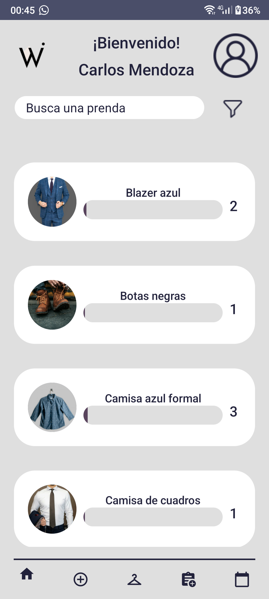
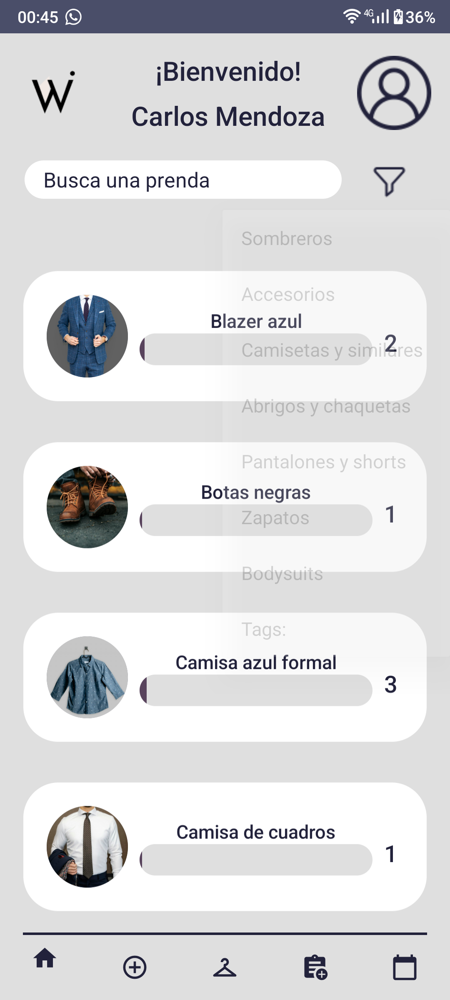
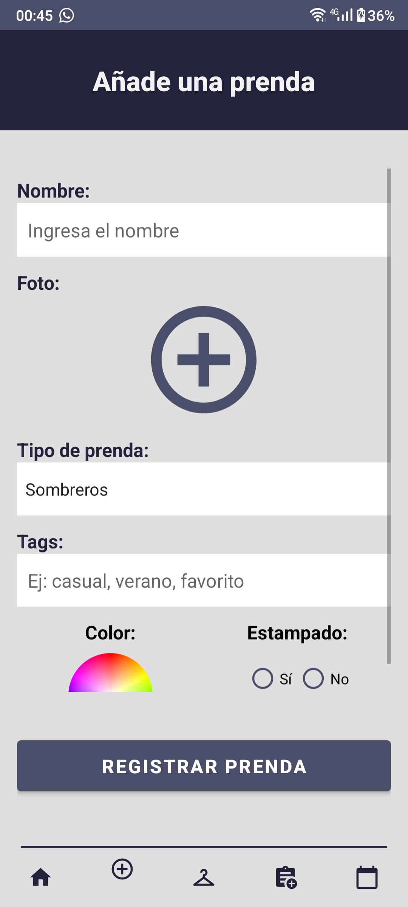
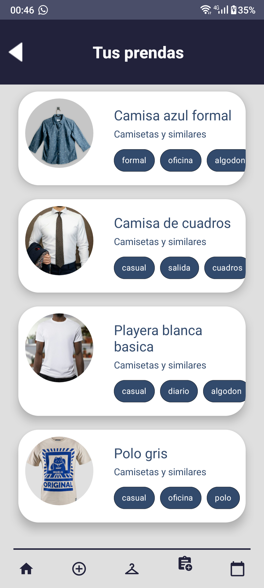
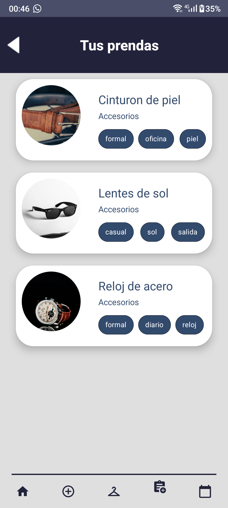
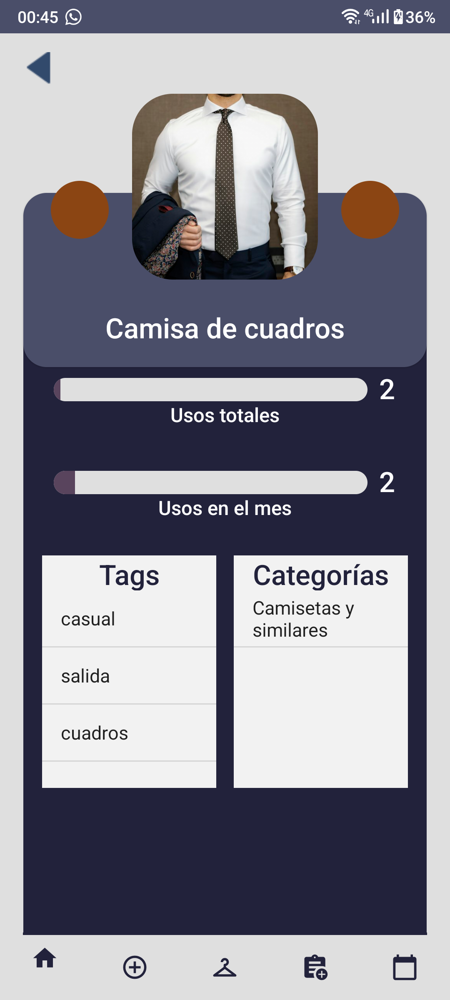
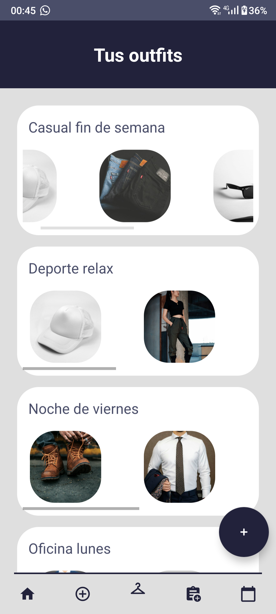
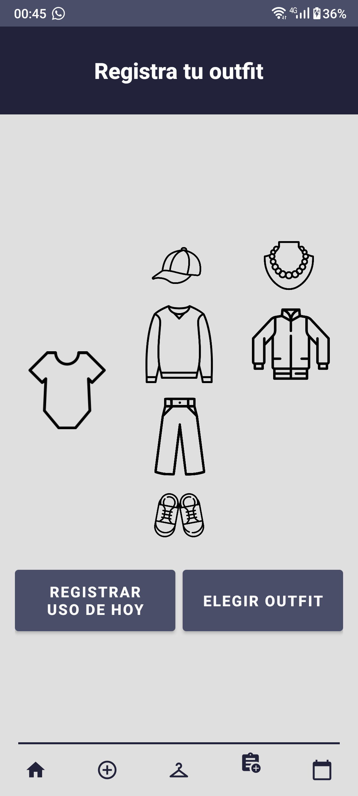
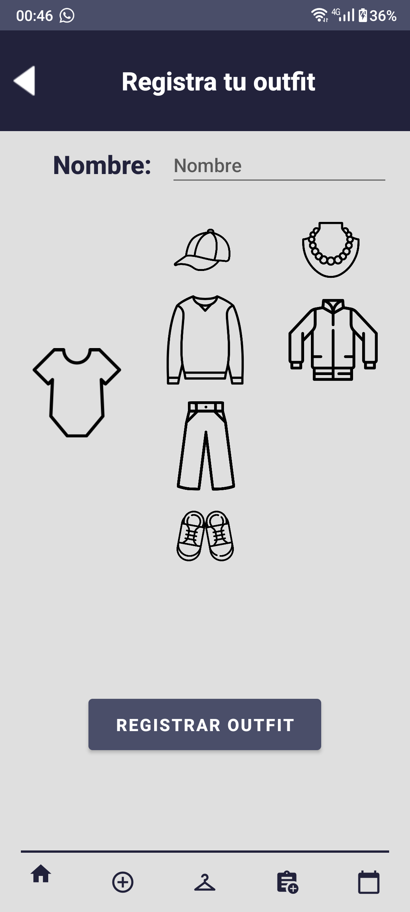
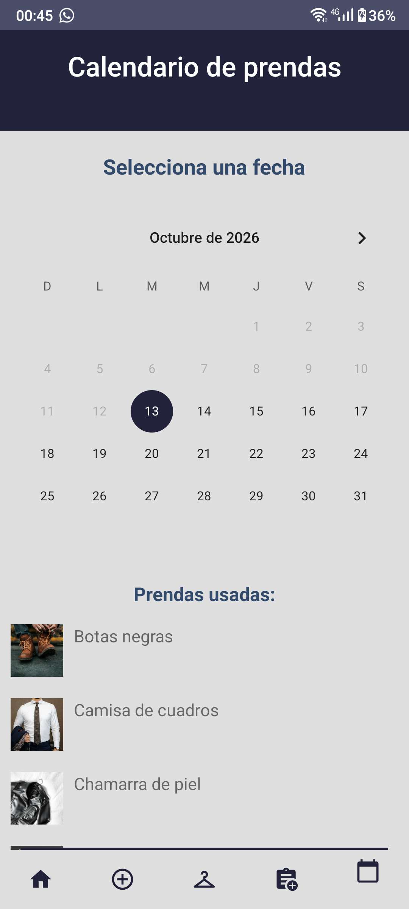

# ClosetVirtual — Android Kotlin

App para gestionar tu vestuario: registra prendas con foto, arma outfits y visualizalos en calendario.

## Stack

`Kotlin`, `Android Studio`, `Firebase Auth`, `Firestore` / `Realtime Database`, `Cloudinary`, `Glide`, `Navigation`, `ViewModel` + `LiveData`, `Material`

## Arquitectura

- Una Activity + Fragments con Navigation (home, ropero, outfits, calendario, perfil).
- MVVM: ViewModel + LiveData por pantalla, adaptadores para listas de prendas/outfits.
- Datos en Firebase (auth + base de datos), imagenes via Cloudinary con carga Glide.
- `minSdk 24`, `targetSdk 35`, ViewBinding activado.

## Como correrlo

```bash
git clone https://github.com/Morales241/ProyectoFinalAppsMoviles.git
# Abrir la carpeta ClosetVirtual en Android Studio
# Agregar tu google-services.json en ClosetVirtual/app/ y sincronizar Gradle
```

En Android Studio: Sync Gradle, elegir dispositivo o emulador, Run.

## Que hice yo

- Registro de prendas con foto, ropero por categorias, armado de outfits y calendario visual.
- Login/registro con Firebase Auth y persistencia en Firestore/Realtime Database.
- Correccion de nombre y tema (Vitual a Virtual) y limpieza de proyecto en rama `reestructuracion`.

## Estado

Funciona en dispositivo (probada en curso). Release v1.0 con APK pendiente de publicar.

## Pantallas

Capturas extraidas del manual (`docs/Manual_Pantallas_ClosetVirtual.pdf`), con descripcion y caso de uso de cada pantalla:

  

  

  



Manual completo: [docs/Manual_Pantallas_ClosetVirtual.pdf](docs/Manual_Pantallas_ClosetVirtual.pdf)
